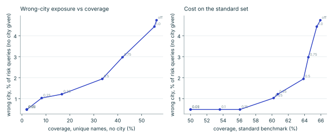

# Evaluation

Generated by `scripts/make_evaluation_md.py` from `docs/eval.json`, `docs/studies.json`,
`docs/sealed/*.json` and `docs/gold.json`. Gazetteer: uae.osm.pbf built 2026-10-09T23:42:19Z.
Splits are by district hash (train 50% / calibration 20% / **dev 20%** / **sealed 10%**).
Dev was used while iterating; sealed was run **once**, after the predictions in
[`PREDICTIONS.md`](PREDICTIONS.md) were written.

## Cross-city answers (Phase 2)

A street or POI name that exists in several cities, written without the city, can be answered
confidently in the wrong one. The synthetic cross-city set pairs the same record at three evidence
levels (E0 street+number only, E1 + district, E2 + city) and over strata *collision* (same street and
number in several cities) and *hole* (the true record is missing while another city has the same
street and number). **Risk** = collision + hole pooled. This set is built to expose the failure; its
rates are not prevalence estimates. `std` = the standard benchmark (n=3000) run under the same flags.
Intervals are Wilson 95%. Predictions and their hits and misses: [`PREDICTIONS.md`](PREDICTIONS.md).

### Dev (all gate margins; 0.35 was chosen here)

| Config | std resolved | std precision | risk E0: answered | risk E0: **wrong city, % of all** | risk E0: asked city | unique E0: answered | unique E0: asked | risk E1: wrong city | risk E2: wrong city |
|---|---|---|---|---|---|---|---|---|---|
| baseline_v2.0 | 69.2% | 99.1% | 10.3% (8.9-11.8) | 10.1% (8.7-11.6) | 0.0% | 72.4% | 0.0% | 0.6% (0.3-1.2) | 0.2% (0.1-0.5) |
| diversify_only | 69.2% | 99.1% | 10.3% (8.9-11.8) | 10.1% (8.7-11.6) | 0.0% | 72.4% | 0.0% | 0.6% (0.3-1.2) | 0.2% (0.1-0.5) |
| gate_1.0 | 68.6% | 99.1% | 10.0% (8.7-11.6) | 9.8% (8.5-11.4) | 0.2% | 69.6% | 2.9% | 0.6% (0.3-1.2) | 0.2% (0.1-0.5) |
| gate_0.75 | 67.4% | 99.2% | 6.9% (5.8-8.3) | 6.7% (5.6-8.1) | 3.3% | 58.4% | 14.0% | 0.6% (0.3-1.2) | 0.2% (0.1-0.5) |
| gate_0.5 | 66.0% | 99.2% | 4.4% (3.5-5.5) | 4.3% (3.4-5.4) | 5.8% | 39.8% | 32.7% | 0.1% (0.0-0.5) | 0.2% (0.1-0.5) |
| gate_0.35 | 65.1% | 99.2% | 3.1% (2.4-4.1) | 3.0% (2.3-3.9) | 7.2% | 30.9% | 41.6% | 0.1% (0.0-0.5) | 0.2% (0.1-0.5) |
| gate_0.25 | 59.6% | 99.3% | 1.6% (1.1-2.4) | 1.5% (1.0-2.2) | 8.6% | 5.1% | 67.3% | 0.0% (0.0-0.4) | 0.2% (0.1-0.5) |
| gate_0.15 | 57.6% | 99.4% | 1.6% (1.1-2.3) | 1.5% (1.0-2.2) | 8.7% | 2.0% | 70.4% | 0.0% (0.0-0.4) | 0.2% (0.1-0.5) |
| gate_0.1 | 52.5% | 99.4% | 1.5% (1.0-2.2) | 1.5% (1.0-2.2) | 8.7% | 2.0% | 70.4% | 0.0% (0.0-0.4) | 0.2% (0.1-0.5) |
| gate_0.05 | 52.5% | 99.4% | 1.5% (1.0-2.2) | 1.5% (1.0-2.2) | 8.7% | 2.0% | 70.4% | 0.0% (0.0-0.4) | 0.2% (0.1-0.5) |
| gate_0.02 | 52.5% | 99.4% | 1.5% (1.0-2.2) | 1.5% (1.0-2.2) | 8.7% | 2.0% | 70.4% | 0.0% (0.0-0.4) | 0.2% (0.1-0.5) |

### Sealed (run once; baseline, diversify-only and the chosen margin)

| Config | std resolved | std precision | risk E0: answered | risk E0: **wrong city, % of all** | risk E0: asked city | unique E0: answered | unique E0: asked | risk E1: wrong city | risk E2: wrong city |
|---|---|---|---|---|---|---|---|---|---|
| baseline_v2.0 | 64.7% | 98.9% | 12.4% (10.6-14.5) | 12.0% (10.2-14.1) | 0.0% | 73.8% | 0.0% | 0.2% (0.1-0.9) | 0.1% (0.0-0.5) |
| diversify_only | 64.7% | 98.9% | 12.4% (10.6-14.5) | 12.0% (10.2-14.1) | 0.0% | 73.8% | 0.0% | 0.2% (0.1-0.9) | 0.1% (0.0-0.5) |
| gate_0.35 | 61.0% | 99.0% | 3.0% (2.2-4.2) | 2.8% (2.0-4.0) | 9.4% | 36.0% | 37.8% | 0.0% (0.0-0.5) | 0.1% (0.0-0.5) |

Reading: with no city given, holes in the registry look identical to unique, present records, so
wrong-city exposure falls only by giving up answers (the gate asks "which city?"). Giving the district
(E1) or city (E2) removes almost all of it. The residual after the gate is mostly rival cities
that are invisible to the system.

## Dubai POI calibration: which v2.1 change caused the regression (Phase 2, T1)

Dev split only, every model retrained on the **2026-10-15** OSM extract (gazetteer
`9372f78d9fae`; the published v2.0 and v2.1 numbers elsewhere in this document used
the 2026-10-09 extract, which the mirror no longer offers). One training seed per model. POI
benchmark n=1500. Source: `docs/poi_ablation.json`; predictions T1.1 to T1.8 in
[`PREDICTIONS.md`](PREDICTIONS.md).

| Model | POI ECE, shipped (95% bootstrap) | POI ECE, gate off | POI ECE, v2.0 flags | POI answered, shipped | POI answered, gate off | risk E0 wrong city, % of all (gate 0.35) | std resolved / precision (gate 0.35) |
|---|---|---|---|---|---|---|---|
| M21: v2.1 as published (features + cross city mix) | 0.103 (0.090-0.117) | 0.103 | 0.103 | 61.7% | 69.6% | 2.2% (1.6-3.0) | 62.4% / 99.2% |
| M20: v2.0 training (no features, no mix) | 0.066 (0.054-0.080) | 0.066 | 0.066 | 65.6% | 73.9% | 6.0% (5.0-7.3) | 61.1% / 98.9% |
| M_nofeat: (a) mix, features masked | 0.102 (0.089-0.117) | 0.102 | 0.101 | 62.9% | 69.7% | 2.6% (1.9-3.5) | 63.2% / 99.1% |
| M_nomix: (b) features, no mix | 0.064 (0.052-0.078) | 0.064 | 0.064 | 65.5% | 73.5% | 6.3% (5.2-7.6) | 62.4% / 99.0% |
| M_nopoihole: fix candidate: mix without `poi_hole` rows | 0.072 (0.060-0.087) | 0.072 | 0.071 | 64.5% | 72.7% | 7.7% (6.5-9.1) | 63.3% / 99.1% |

Reading: ECE does not move with the gate or with diversification; it moves with the training mix.
Removing the cross city mix (or only its `poi_hole` rows) restores v2.0 POI calibration, but the
same rows are what keep the model cautious about street names shared across cities, so address
wrong city exposure roughly triples. Under the rule fixed before the run, no candidate qualified
and the published v2.1 model is kept. **Trade off, stated plainly: better Dubai POI calibration
currently costs about three times the wrong city exposure on the address risk set.**

## Answering "Which city?" (Phase 2, T2)

Cross city dev set, model M21 above, shipped flags. Every E0 query that came back with a
"Which city?" question is resolved again with the true city as the `city` hint. In hole strata the
true record is hidden, but another OSM record (a duplicate or a neighbouring entrance) can lie
within 50 m of it, so some answers there are close. Source: `docs/clarify_dev.json`.

| Group | E0 queries | asked "Which city?" | with the true city: resolved within 50 m | resolved beyond 50 m | resolved in another city | same status as E2 |
|---|---|---|---|---|---|---|
| non hole | 1498 | 16.6% (14.8-18.5) | 99.6% (97.8-99.9) | 0.0% (0.0-1.5) | 0.0% (0.0-1.5) | 100.0% (98.5-100.0) |
| hole | 1048 | 12.2% (10.4-14.3) | 32.0% (24.6-40.5) | 1.6% (0.4-5.5) | 0.0% (0.0-2.9) | 100.0% (97.1-100.0) |

## Dubai POI supplements: Overture Places and GeoNames (Phase 2, T4)

**Mixed truth**: OSM, Overture and GeoNames are each someone's claim; agreement is not accuracy,
and a place found only in a supplement has no independent truth here. Nothing was merged into the
gazetteer. Source: `docs/supplements_dubai.json`.

| Measure | Value |
|---|---|
| Overture Places rows in the Dubai bbox | 104,442 |
| ...with only CDLA Permissive 2.0 / Apache 2.0 / CC0 source licences | 100.0% (100.0-100.0) |
| OSM dev Dubai POIs (n=2034) with an Overture place of the same name key within 100 m | 9.1% (7.9-10.4), median 18 m |
| Overture places with confidence at least 0.7 (n=49912) and no OSM POI of the same key within 500 m | 91.4% (91.1-91.6) |
| GeoNames feature class S rows in the bbox | 1,890 |
| ...without an OSM POI of the same key within 500 m | 1,633 |

## Last meter entrance proposals (EXPLORATORY, Phase 2, T6)

Exploratory, not a headline claim. Labels are OSM mapped entrance vertices on building outlines in
the Abu Dhabi emirate (`entrance=*` or `door=*`), **not surveyed**. The query point is the outline
centroid and mapped entrances are hidden. Shares are over all labelled buildings (no proposal
counts as a miss), Wilson 95%. Source: `docs/lastmeter_eval.json`.

n=242 labelled buildings, 410 mapped entrances.

| Proposer | within 5 m | within 10 m | within 20 m | median m (where proposed) | no proposal |
|---|---|---|---|---|---|
| centroid | 13.2% (9.5-18.1) | 29.8% (24.3-35.8) | 54.5% (48.2-60.7) | 16.3 | 15 |
| nearest_road_point | 6.2% (3.8-10.0) | 11.6% (8.1-16.2) | 27.7% (22.4-33.6) | 31.9 | 20 |
| outline_nearest_road | 15.7% (11.7-20.8) | 24.0% (19.0-29.7) | 40.5% (34.5-46.8) | 24.7 | 15 |
| path_endpoint | 53.3% (47.0-59.5) | 59.9% (53.6-65.9) | 69.0% (62.9-74.5) | 0.0 | 30 |

`path_endpoint` partly reads the label: OSM mappers usually join a footway to the entrance node
itself, so on these buildings the hidden entrance is encoded in the path geometry. How well it works
where entrances are not mapped is unknown.

## Read this first

- Queries are **synthetic** (two generators, one independent of training) plus a 40-row hand-written set. No query comes from a real user. Absolute numbers are optimistic; relative comparisons and calibration are the findings.
- Ground truth is the OpenStreetMap point the query was written about.
- Dubai has almost no structured OSM addresses, so only Dubai/Sharjah/Ajman POI queries are evaluated there.
- The hand-written set was used to find one defect (interior street-type spans), so its score is no longer an untouched estimate.

## Headline: sealed split, frozen v2.0 release (model before Phase 2)

| Benchmark | n | resolved | precision@50 m of resolved | top-1 ≤50 m (forced) | ≤1 km | ECE P(≤50 m) | median ms |
|---|---|---|---|---|---|---|---|
| Abu Dhabi / Al Ain / Al Dhafra, held-out districts | 6000 | 65.5% | **98.7%** | 68.3% | 76.8% | 0.030 | 5.8 |
| Same, true address removed from the index | 3000 | 49.0% | **86.6%** | 44.5% | 62.7% | 0.039 | 6.2 |
| Dubai / Sharjah / Ajman POI (weaker truth) | 1500 | 76.6% | **98.7%** | 78.5% | 80.8% | 0.054 | 4.6 |

## Headline: dev split (v2.1: city gate on, retrained)

| Benchmark | n | resolved | precision@50 m of resolved | top-1 ≤50 m (forced) | ≤1 km | ECE P(≤50 m) | median ms |
|---|---|---|---|---|---|---|---|
| Abu Dhabi / Al Ain / Al Dhafra, held-out districts | 6000 | 64.7% | **99.2%** | 72.1% | 80.1% | 0.030 | 6.2 |
| Same, true address removed from the index | 3000 | 45.2% | **87.9%** | 43.0% | 65.9% | 0.033 | 6.5 |
| Dubai / Sharjah / Ajman POI (weaker truth) | 1500 | 63.3% | **99.5%** | 72.9% | 75.5% | 0.105 | 4.5 |

"Forced" counts the best candidate even where tahdeed would have abstained or given only an area. "Resolved" is the confident answer.

## When the true address is not in the registry (sealed)

| Share of queries whose true address is absent | resolved | precision@50 m of resolved | forced top-1 ≤50 m | ECE P(≤50 m) |
|---|---|---|---|---|
| 0% | 64.3% | 98.7% | 67.4% | 0.018 |
| 15% | 61.5% | 97.3% | 63.5% | 0.012 |
| 30% | 58.7% | 95.8% | 59.6% | 0.014 |
| 50% | 55.7% | 93.3% | 55.0% | 0.023 |
| 100% | 48.2% | 86.0% | 43.3% | 0.046 |

Calibration (ECE) stays low across the range but precision cannot: a registry hole produces a confident wrong neighbour. This is a limit of the data, which only an official registry fixes.

## Does it hold on queries we did not write? (sealed)

| Query generator | forced top-1 ≤50 m | resolved | precision of resolved | ECE P(≤50 m) |
|---|---|---|---|---|
| v1: English names perturbed (the training generator) | 66.5% | 63.2% | 98.6% | 0.025 |
| v2: Latin text produced from the Arabic names (independent) | 66.0% | 64.8% | 97.2% | 0.014 |
| &nbsp;&nbsp;v2 style `gulf` (n=985) | 69.9% | 68.2% | 98.1% | 0.021 |
| &nbsp;&nbsp;v2 style `arabizi` (n=641) | 53.7% | 55.7% | 92.7% | 0.031 |
| &nbsp;&nbsp;v2 style `formal` (n=874) | 70.6% | 67.7% | 99.0% | 0.021 |

## Which components earn their keep? (sealed; dev in `studies.json`)

| Configuration (n=5000, 30% holes, v1+v2 mix) | forced top-1 ≤50 m | Δ vs full (95% paired CI) | precision of resolved | ECE |
|---|---|---|---|---|
| full system | 60.0% | - | 95.2% | 0.015 |
| - consonant-class matching (coarse) | 60.0% | +0.0 (+0.0..+0.0) ns | 95.2% | 0.015 |
| - sibling street keys | 60.4% | +0.4 (-0.1..+0.8) ns | 94.8% | 0.015 |
| - full-name fuzzy spans | 58.3% | -1.8 (-2.2..-1.4) | 94.8% | 0.016 |
| - DP span selection (greedy) | 56.2% | -3.9 (-4.5..-3.3) | 94.6% | 0.021 |
| - interpolation | 50.1% | -9.9 (-10.8..-9.1) | 95.7% | 0.015 |
| - all three recall aids | 57.6% | -2.4 (-3.1..-1.7) | 94.0% | 0.017 |
| - isotonic calibration | 60.1% | +0.1 (-0.0..+0.2) ns | 95.1% | 0.012 |
| hand-set confidence instead of GBM | 28.6% | -31.4 (-32.7..-30.1) | 85.6% | 0.304 |
| trained without hole examples | 56.8% | -3.2 (-3.8..-2.6) | 93.7% | 0.050 |
| Baseline: char 3-4-gram TF-IDF nearest neighbour | 35.5% | -24.6 (-26.4..-22.8) | - | - |

`ns` = interval spans zero. Dev-split ablations: see `docs/studies.json`.

## Landmark queries ("near X, city")

Sealed: 75.8% within 200 m of the landmark with the landmark tier, 0.0% without (n=1500). Dev: 75.3% within 200 m of the landmark with the landmark tier, 0.1% without (n=1500). Truth is the landmark's own point, so this tests finding the landmark, not the offset that "near" implies.

## Hand-written gold set

40 queries written by a person; 30 resolved, 29 of those within 50 m; forced top-1 ≤50 m 85.0%. Sampling uncertainty at n=40 is about ±13 points. See the caveat above.

## Known failures

- A street name that exists in several cities, written without the city, is still answered in the wrong city when the true record is missing from the registry (a hole looks like a unique, present record). The city gate lowers this at a coverage cost; the residual is shown in the cross-city section.
- v2.1 regression: Dubai/Sharjah/Ajman POI calibration (ECE of P(within 50 m)) is worse than v2.0 on dev, and POI answers are fewer because chain names now trigger the city question. Diagnosed (T1 section above): the cross city training mix, mostly its `poi_hole` rows, causes the ECE rise; removing them would roughly triple address wrong city exposure, so they are kept and the trade off stands.
- Registry holes (above).
- Arabizi remains the weakest style.
- Interpolation (+10 points forced top-1) assumes house numbers increase along a street and is checked only against held-out OSM addresses.
